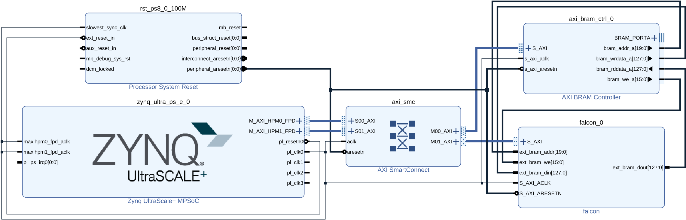

# Falcon FPGA Implementation

This is a hardware implementation of the Falcon post-quantum signature scheme on FPGA, targeting Xilinx Zynq UltraScale+ devices. Both signature generation and signature verification are supported for Falcon-512 and Falcon-1024 variants.

The accelerator was developed as part of a Master's thesis at the University of Ljubljana, Faculty of Computer and Information Science and Graz University of Technology.


## Repository layout

```txt
.
├── Makefile             - entry point for lint, tests and the Vivado flow (run `make help`)
├── rtl/                 - synthesizable SystemVerilog of the accelerator (vendor-neutral)
│   ├── files.f          - file list shared by Verilator, xsim and the Vivado scripts
│   ├── top/             - axi_wrapper (top), instruction_dispatch, control_unit
│   ├── common/          - BRAM, counters, delay registers, common_definitions.vh
│   ├── ntt/             - NTT/INTT and modular multiplication
│   ├── fft/             - FFT/IFFT, split/merge, twiddle factor ROM
│   ├── fp/              - floating-point arithmetic
│   ├── samplerz/        - SamplerZ (ChaCha20, BerExp, ...)
│   ├── hash_to_point/   - SHAKE256 and hash-to-point
│   ├── compress/        - signature compression and decompression
│   └── verify/          - norm bound check
├── tb/sv/               - SystemVerilog testbenches (+ wcfg/ waveform configurations)
├── mem/                 - memory images loaded by testbenches ($readmemh hex files)
├── vivado/              - everything Vivado-specific, as Tcl scripts
│   ├── create_project.tcl     - RTL + testbench project for GUI work
│   ├── package_ip.tcl         - packages the accelerator as IP core user.org:user:falcon:1.0
│   ├── create_bd_project.tcl  - Zynq project with the block design
│   ├── build.tcl              - bitstream + .xsa
│   └── bd/falcon_bd.tcl       - the block design (exported with write_bd_tcl)
├── sw/src/              - bare-metal software for the ARM cores
├── scripts/             - Python/Tcl utilities used during development
├── results/cycles/      - cycle count measurements
└── docs/                - images and documentation
```

All generated files (Vivado projects, packaged IP, simulation runs, bitstreams, `.xsa`) go to `build/`, which is not tracked.

## Requirements

- Vivado on path
- Verilator (optional, for `make lint`)
- Vitis, for the software part

## Simulation

All testbenches in `tb/sv/` are self-checking and run in xsim:

```bash
make test-sv                                       # all tests in parallel (JOBS=<n>, default: number of CPUs)
make test-sv TESTS=ntt_512_tb                      # only the listed tests
make test-sv TESTS="fp_adder_tb instruction_dispatch_tb_sign512"
```

Each test prints PASS or FAIL; logs are in `build/xsim/<test>/` and the summary in `build/test-results.txt`.
A test fails if it reports an error or does not finish within `SIM_TIME` (default 20 ms of simulated time).

The tests are:

- `<module>_tb`: one per module, comparing against reference values or a reference model
- `instruction_dispatch_tb_{sign512,sign1024,verify512,verify1024}`: the whole accelerator, with the BRAMs preloaded
  from `mem/instruction_dispatch_tb/<data set>/`. Verification must accept the data set's signature and reject a
  corrupted one. Signing must produce `expected_signature.hex`, which is then verified with the `verify<N>` public key,
  like the software does.

`scripts/falcon_verify.py` checks a generated signature independently of the hardware:

```bash
python3 scripts/falcon_verify.py 512 mem/instruction_dispatch_tb/verify512/bram0.hex mem/instruction_dispatch_tb/verify512/bram6.hex \
        build/xsim/instruction_dispatch_tb_sign512/generated_signature.hex
```

### Simulating in the Vivado GUI

```bash
make project                # creates build/vivado/falcon_ip.xpr
vivado build/vivado/falcon_ip.xpr
```

The project references the files in `rtl/` and `tb/` directly, so edits made in the GUI end up in the repository. The simulation set is configured to run `instruction_dispatch_tb` with the `sign512` BRAM contents; change `FALCON_BRAM_INIT_DIR` under *Simulation Settings > Verilog options* and the `N`/`ALGORITHM` generics to use another data set.

## Analyzing cycle counts

1. Enable the `PRINT_CYCLES` define in `rtl/common/common_definitions.vh`
2. Run the simulation; module state changes are appended to `cycles_output.txt` in the simulation directory (e.g. `build/xsim/instruction_dispatch_tb_sign512/`)
3. Analyze it:

   ```bash
   python3 scripts/calculate_cycles.py build/xsim/instruction_dispatch_tb_sign512/cycles_output.txt
   ```

This shows cycle counts broken down by module (COPY, HASH_TO_POINT, FFT_IFFT, NTT, etc.). See the header of `scripts/calculate_cycles.py` for details. Measured results are in `results/cycles/`.

## Hardware build

```bash
make ip                     # package the IP core into build/ip_repo/falcon
make bd N=1024              # block design project in build/bd_1024 (open it in the GUI if needed)
make xsa N=1024             # bitstream and build/falcon_1024.xsa, plus utilization/timing reports
```

`N` (512 or 1024) selects the Falcon variant. The block design was made for the TUL PYNQ-ZU board (part `xczu5eg-sfvc784-1-e`); its board files are used if installed, but they are not required.



The block design contains:

- **falcon**: the accelerator. AXI-Lite is used for control and BRAM signals are exposed for data transfer (see `rtl/top/axi_wrapper.sv`).
- **AXI BRAM Controller**: interface between AXI and the accelerator's BRAMs (AXI4, 128-bit data, read latency 2, one BRAM interface, no ECC)
- **Zynq UltraScale+ MPSoC**: processing system, PL clock 125 MHz

To change the block design, open the project created by `make bd`, make the changes and export it back to the repository from the Tcl console:

```tcl
write_bd_tcl -force -no_ip_version -include_layout <repo>/vivado/bd/falcon_bd.tcl
```

See [Zynq Software Custom IP Guide](https://github.com/vidvidex/zynq-software-custom-ip-guide) for more information about creating a block design with a custom IP core and using it from software.

## Software

`sw/src/` contains bare-metal (no operating system) software that loads data onto the FPGA and performs signature generation and verification using the accelerator.

**Important:** change the `N` define in `main.h` to select between the N=512 and N=1024 variants. It must match the `N` used for the hardware build.

To build it with Vitis, create a platform from `build/falcon_<N>.xsa` (standalone, `psu_cortexa53_0`) and an application component with the sources from `sw/src/`. Keep the Vitis workspace outside the repository or in `sw/workspace/` (ignored by git). See <https://github.com/vidvidex/zynq-software-custom-ip-guide?tab=readme-ov-file#developing-software-with-vitis-ide>.
