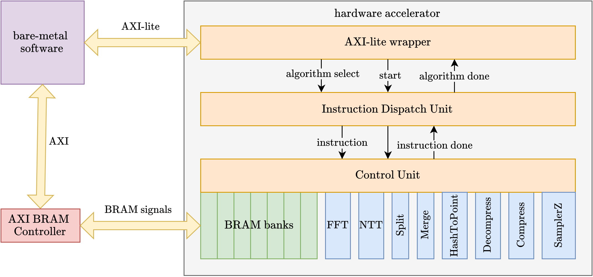

# Falcon FPGA Implementation

This is a hardware implementation of the Falcon post-quantum signature scheme on FPGA, targeting Xilinx Zynq UltraScale+ devices. Both signature generation and signature verification are supported for Falcon-512 and Falcon-1024 variants.

**Development Environment:** Vivado 2023.1

The accelerator was developed as part of a Master's thesis at the University of Ljubljana, Faculty of Computer and Information Science and Graz University of Technology.

## Project Structure

This project is composed of several key components:

- Hardware accelerator (see `ip/` directory)
- Block design integrating the accelerator with the Zynq processing system (see `bd/` directory)
- Software running on the ARM processor to interface with the hardware (see `sw/` directory)
- Utility scripts used during development (see `utilities/` directory)



### `ip/`

Contains the Vivado project (`falcon_ip.xpr`) that implements the accelerator for the Falcon signature scheme. If you cannot open the project directly, you can create a new Vivado project and add the source files from the `falcon_ip.srcs/` directory (source files, simulations and IP blocks).

The accelerator can be packaged as an IP core and integrated into other Vivado designs. AXI-Lite is used to control the accelerator and BRAM signals are exposed for data transfer (see `axi_wrapper.sv`).

```txt
ip/falcon_ip.srcs
├── sim_1
│   ├── new                     - simulation sources
│   └── wcfg                    - simulation wave configuration files
└── sources_1                   - Top level HDL source files
    ├── coefficients            - pre-computed constants (such as twiddle factors), BRAM contents for simulations
    ├── compress_decompress     - compression and decompression modules
    ├── fft                     - FFT, IFFT and related modules
    ├── fp_operations           - floating-point arithmetic modules
    ├── hash_to_point           - hash-to-point and related modules
    ├── ip                      - IP cores used in the design
    ├── ntt                     - NTT module
    └── samplerz                - SamplerZ and related modules
```

### `bd/`

Contains the Vivado project (`falcon_bd.xpr`) that combines the Falcon IP core with the Zynq processing system. If you cannot open the project directly, this section contains all the necessary information to recreate the block design.

See [Zynq Software Custom IP Guide](https://github.com/vidvidex/zynq-software-custom-ip-guide) for more information about creating a block design with custom IP core and using it from software.


IP blocks and configuration:

- **falcon**
  - Parameter `N` set to either 512 or 1024, depending on the desired security level
- **AXI BRAM Controller**: Interface between AXI and BRAM modules
  - `AXI protocol`: AXI4
  - `Data Width`: 128
  - `Memory Depth (Auto)`: [Set by changing the address space size in Address Editor](https://github.com/vidvidex/zynq-software-custom-ip-guide?tab=readme-ov-file#address-space-configuration)
  - `Read Latency`: 2
  - `Number of BRAM interfaces`: 1
  - `Enable ECC`: No
- **Zynq UltraScale+ MPSoC**: Processing system
  - Clock frequency can be changed (default: 100 MHz, this project uses 125 MHz)

### `sw/`

Contains bare-metal (without an operating system) software that can load data onto the FPGA and perform signature generation and verification using the Falcon hardware accelerator.

**Important:** Change the `N` define in `main.h` to select between N=512 and N=1024 variants.

This software can be built using the Vitis IDE. See <https://github.com/vidvidex/zynq-software-custom-ip-guide?tab=readme-ov-file#developing-software-with-vitis-ide> for more information.

### `utilities/`

Python scripts and TCL utilities for development. Each script has a header with some explanation of its purpose.

## Running Behavioral Simulations

Almost every HDL module has a corresponding testbench file in the `ip/falcon_ip.srcs/sim_1/new` directory.

At the highest level, `instruction_dispatch_tb.sv` can be used to simulate the entire accelerator. It can be very slow but it checks if the entire design is working as expected. Before using, you need to make sure the BRAMs contain the correct data:

1. Uncomment `DEBUG_BRAMS` define
2. Copy `bram{0-6}.coe` files from `ip/falcon_ip.srcs/sim_1/new/brams_for_instruction_dispatch_tb` into `ip/falcon_ip.srcs/sources_1/coefficients/`
3. Clear BRAMs by right-clicking on them and selecting `Reset Output Products`
4. Run the simulation (will take a long time)

## Analyzing Cycle Counts

To measure performance:

1. Enable `PRINT_CYCLES` define
2. Run simulation
3. Use the analysis script:

   ```bash
   python3 utilities/calculate_cycles.py simulation_output.txt
   ```

This will show cycle counts broken down by module (COPY, HASH_TO_POINT, FFT_IFFT, NTT, etc.).

See header of `utilities/calculate_cycles.py` for more details.

## Combining Hardware and Software

See <https://github.com/vidvidex/zynq-software-custom-ip-guide?tab=readme-ov-file>


## TODO

- `compress` module should be optimized to use only 24-bit compressed format instead of 105-bit
  - both `compress_tb` and `compress_coefficient_tb` have to be fixed. It seems like at some point the module was changed but the testbenches were not updated accordingly.
